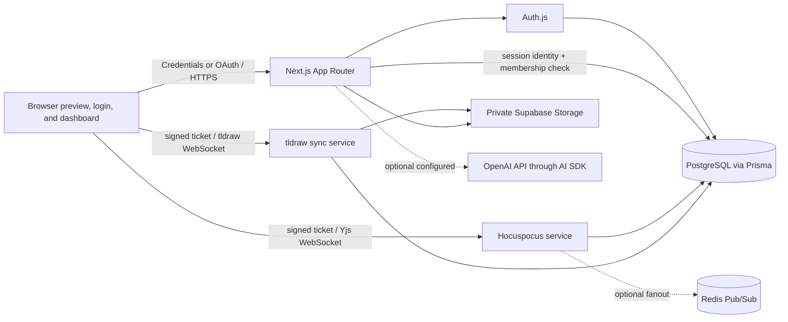

# Architecture

## Current implementation

- Next.js 16 App Router, React 19, strict TypeScript, Tailwind CSS v4, and a responsive local-preview dashboard.
- Auth.js v4 with Prisma adapter, JWT sessions (required by the Credentials provider), scrypt password hashes, and optional Google OAuth.
- PostgreSQL through Prisma with UUID-based tenant models, comment/history APIs, and migrations for password hashes and durable Yjs state.
- Route handlers implement authenticated workspace and document CRUD. Shared server authorization resolves the current session and checks workspace ownership/membership and role.
- `/` remains a browser-local preview; `/dashboard` is connected to the authenticated database APIs and document editor.
- In configured Hocuspocus sessions, Yjs is authoritative: accepted updates are merged with PostgreSQL state and the Tiptap JSON projection is written transactionally before broadcast. JSON-only autosaves use revision checks; restore and deletion coordinate with the collaboration service. The browser keeps offline Yjs edits in IndexedDB and reconnects the same document rather than switching to a competing JSON editor. A signed short-lived ticket authorizes each WebSocket document.

## Request flow

## Security rules

- The browser never supplies the acting user, workspace owner, or role.
- Route handlers and Server Actions are public request boundaries: validate inputs and authenticate/authorize every mutation.
- Read queries constrain requested workspace/document IDs to current membership before fetching data.
- The root preview is not persisted or collaborative; use `/dashboard` for database-backed work.
- Hocuspocus rechecks membership per connection and enforces read-only roles; Redis is fanout, while PostgreSQL stores durable Yjs updates.
- The tldraw sync service rechecks membership before upgrade, enforces readonly sessions, and snapshots each room to `Document.content`. Keep one active room owner per document; the current process-local room map is not safe to fan out without document-aware routing or a distributed coordinator.

## Delivery sequence

1. Authenticated CRUD/schema foundation: implemented but not database-deployed or end-to-end exercised.
2. Tiptap editor, authenticated Hocuspocus/Yjs persistence, comments/history, workspace invitations: implemented but not live-service tested.
3. tldraw collaboration, Supabase image storage, optional AI streaming, title search, and command palette: implemented but dependent integrations are not live-tested.
4. Registration abuse controls, scalable canvas room routing, deep content search/tree navigation, monitoring, browser/load validation, and live deployment remain. Redis-backed fixed-window limits for the current AI/invitation/upload/search routes are implemented.

See `DEVELOPMENT_PROGRESS.md` for exact implementation and verification status.
